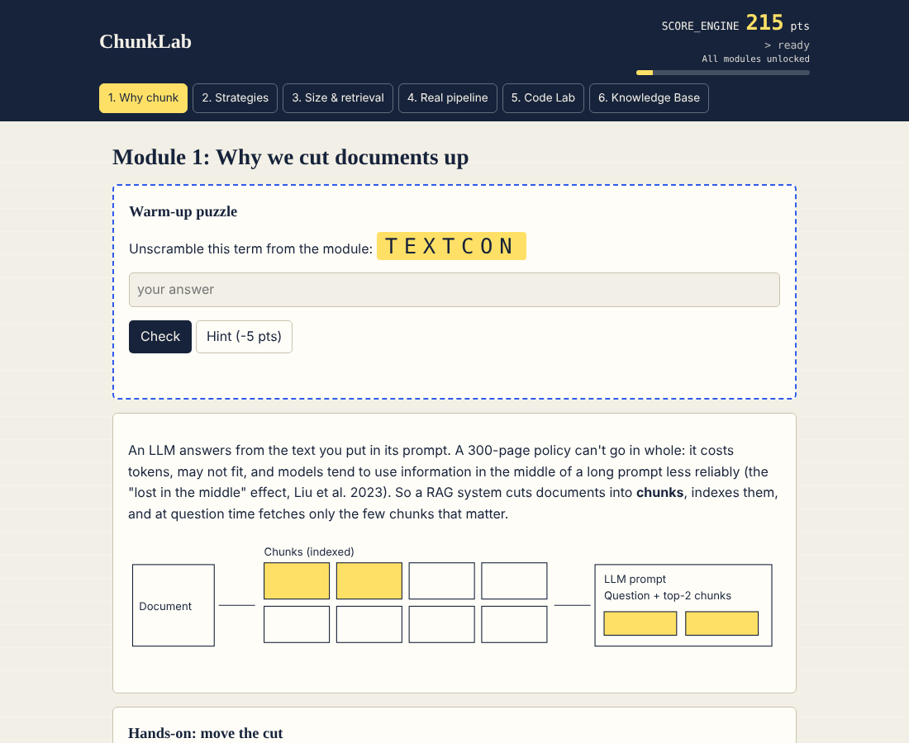
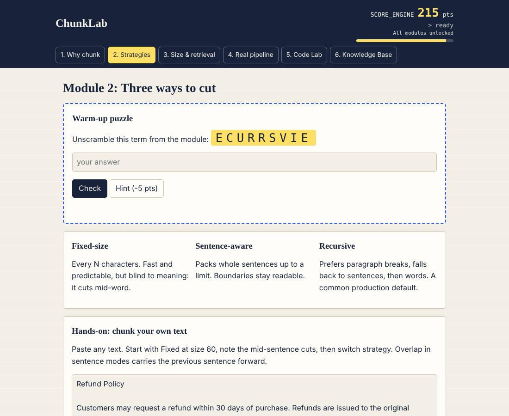
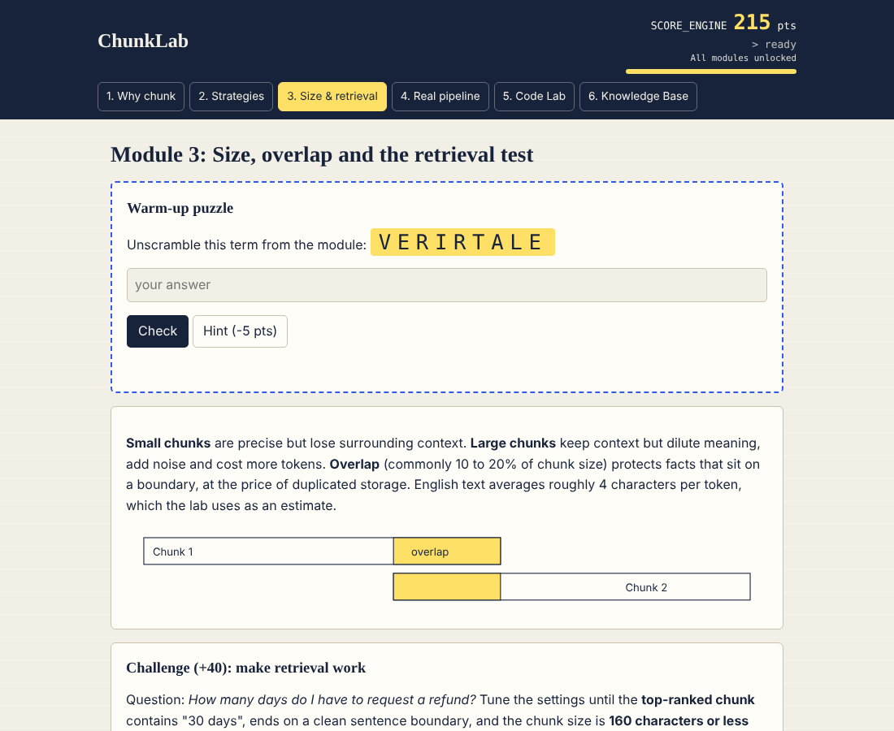
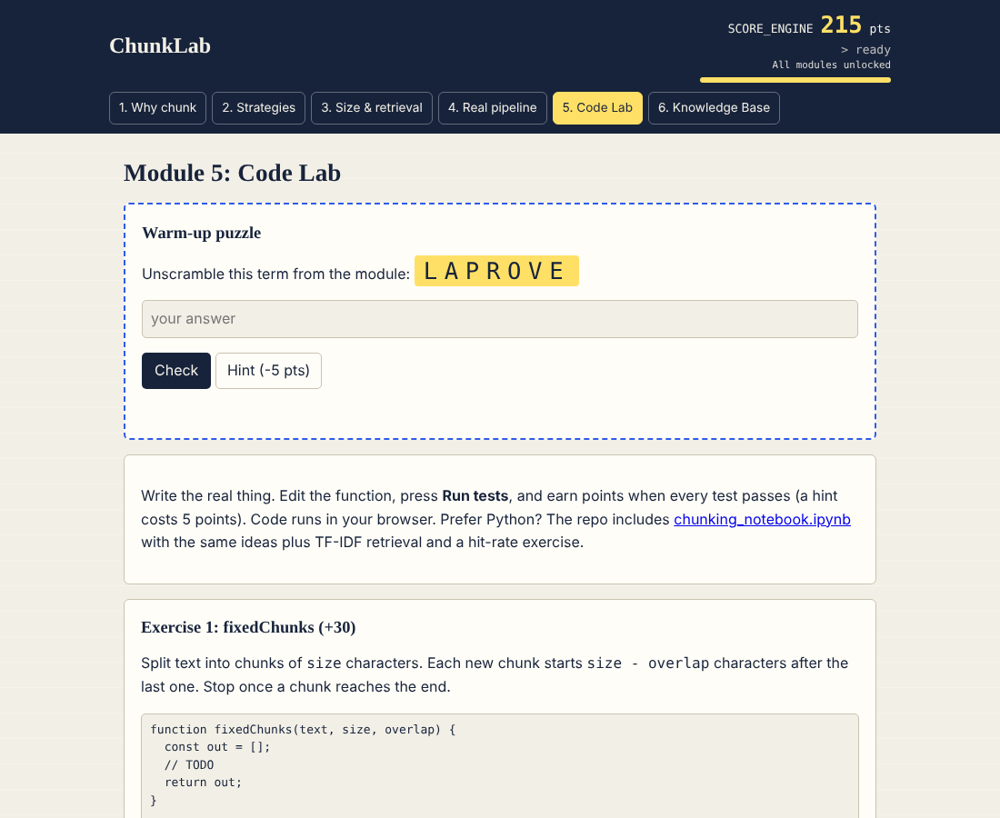
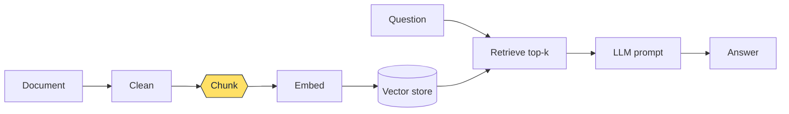

<div align="center">

# ✂️ ChunkLab

### Learn text chunking for RAG by breaking it, fixing it and coding it

An interactive, gamified 45-minute course on **Text Chunking and Document Processing for RAG**.
No installs, no API keys, no backend. Open the page and start learning.

[](https://swasthikaselvakumar.github.io/chunklab/)
[](https://colab.research.google.com/github/SwasthikaSelvakumar/chunklab/blob/main/chunking_notebook.ipynb)


</div>

---

## 🎯 Why chunking?

Most RAG tutorials jump straight to vector databases and models. But the quiet failure point comes earlier: **how the document is cut up.**

If a fact like *"within 30 days of purchase"* is split across two chunks, retrieval cannot find it whole, and even a great model answers badly. ChunkLab lets learners **see that failure happen, then fix it themselves.**

<div align="center">



</div>

## 📚 What learners will be able to do

- Explain why documents are chunked before embedding and retrieval
- Compare **fixed-size**, **sentence-aware** and **recursive** chunking
- Tune **chunk size and overlap**, and explain the trade-offs
- Rank chunks with **TF-IDF** and measure retrieval with a **hit rate**
- Choose a chunking strategy by document type (FAQ, code, transcript, contract)
- Keep **metadata** with every chunk so answers can cite their source

## 🗺️ The 45-minute plan

| Module | Topic | Hands-on activity | Est. time |
|---|---|---|---|
| **1** | Why we cut documents up | Drag a cut point and watch a fact break | 7-8 min |
| **2** | Three ways to cut | Live chunk visualizer on your own text | 9-10 min |
| **3** | Size, overlap and retrieval | **Challenge:** tune settings until the right chunk is retrieved | 10-12 min |
| **4** | From lab to real pipeline | **Chunk Doctor:** prescribe a strategy per document type | 8-9 min |
| | **Core lesson (Modules 1-4)** | | **~40 min + buffer** |
| **5** | Code Lab *(extension)* | Write real chunking functions with auto-graded tests | 12-15 min |

Every module follows the same loop: **warm-up puzzle → explanation with a visual → hands-on activity → knowledge check.**

## 🕹️ Gamified learning

| Mechanic | How it works |
|---|---|
| **Score engine** | A live panel in the header logs every point event |
| **Warm-up puzzle** | Unscramble a key term to unlock each module (+15, or +10 with a hint) |
| **Quizzes** | First try +10, retry +5. Each module has a bonus question (+20 / +10) |
| **Perfect-round bonus** | +15 for finishing a module quiz with no wrong answers |
| **Unlock targets** | Modules 2-5 need 30 / 70 / 120 / 180 points **and** the previous quiz completed |
| **Ranks** | Chunk Apprentice, Pipeline Builder, Chunk Architect |

The header always tells learners exactly what is still missing to unlock the next module.

## 🧪 Interactive highlights

<table>
<tr>
<td width="50%"><b>Chunk visualizer</b><br>Paste any text, switch strategy, and watch colour-coded chunks, token estimates and mid-sentence cuts update live.<br><br></td>
<td width="50%"><b>Retrieval challenge</b><br>Tune strategy, size and overlap until the top-ranked chunk holds the full answer. Size is capped at 160 characters, so giant chunks can't win.<br><br></td>
</tr>
</table>

<div align="center">

**Code Lab:** write the functions yourself, run tests in the browser, earn points when they pass.



</div>

There is also an always-open **Knowledge Base** with searchable terms and code snippets in JavaScript and Python.

## ⚙️ How it works



ChunkLab zooms into the highlighted step. The retrieval lab ranks chunks with **TF-IDF** (a word counts more when it is frequent in a chunk but rare across chunks), then returns the top result. Production systems typically replace this with embeddings, but the logic is the same: **score, rank, take the top k.**

## 🐍 Python notebook

`chunking_notebook.ipynb` takes the same ideas into code, using only the Python standard library.

1. Build fixed-size, sentence-aware and recursive chunkers from scratch
2. Implement TF-IDF retrieval
3. **Exercise 1:** tune settings until retrieval works
4. **Exercise 2:** compute a retrieval hit rate
5. **Exercise 3:** attach metadata to every chunk

Instructors can use `chunking_notebook_solved.ipynb` for the answers.

## 🌍 Real-world relevance

Chunking sits in the middle of every RAG pipeline, so it shapes customer-support bots, document Q&A, enterprise search and code or legal assistants. Production teams size chunks in **tokens** (model limits are in tokens), store **metadata** (source, page, section), and evaluate with **hit rate on real questions** instead of judging by eye.

## 🚀 Run it

**Online:** open the [live demo](https://swasthikaselvakumar.github.io/chunklab/).

**Locally:** it is a single static file.

```bash
git clone https://github.com/SwasthikaSelvakumar/chunklab.git
cd chunklab
# open index.html in any modern browser
```

**Notebook:** click the Colab badge above, or run `jupyter notebook chunking_notebook.ipynb`.

## 📁 Project structure

```
chunklab/
├── index.html                       # the whole course (HTML, CSS, JS in one file)
├── chunking_notebook.ipynb          # student notebook with exercises
├── chunking_notebook_solved.ipynb   # instructor notebook with solutions
├── screenshots/                     # images used in this README
└── README.md
```

## 🧠 Design decisions

- **One file, no backend:** a reviewer can open it instantly and it works offline.
- **Retrieval before theory:** learners see a fact break first, so the explanation has something to attach to.
- **Constraints that teach:** the 160-character cap on the challenge forces real trade-offs instead of one giant chunk.
- **Honest limits:** the lab uses TF-IDF for transparency. The notebook points to embeddings as the next step.

## 👩‍💻 Author

**Swasthika Selvakumar**, B.Tech CSE (AI/ML), SRM Institute of Science and Technology
[GitHub](https://github.com/SwasthikaSelvakumar) · [LinkedIn](https://www.linkedin.com/in/swasthika-selvakumar-708440289)

Built as a teaching artifact for the Instructional Designer Intern (AI Courses) task.


